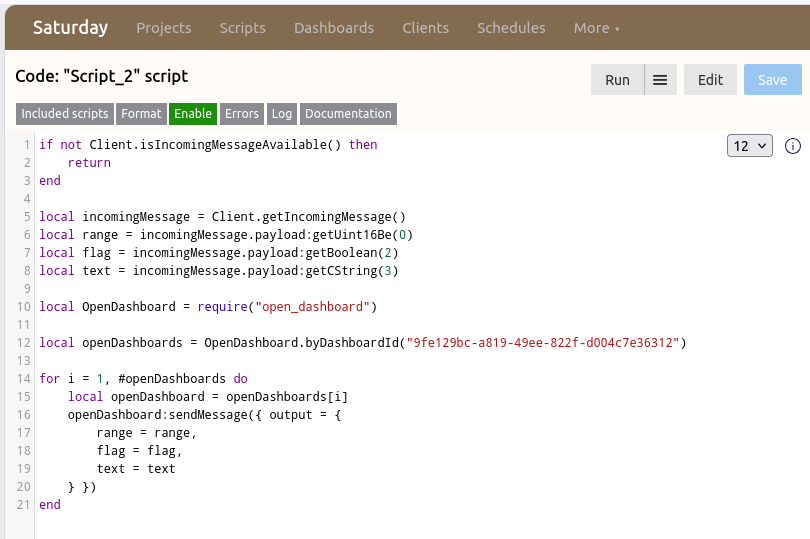

# Saturday

[English] | [Українська](doc/README.uk.md)

---

> [!WARNING]
> **Development Status: Public Beta**
> This project is currently in beta testing. The system is fully functional, but may contain undiscovered bugs, unstable features, or documentation inaccuracies.

---

**Saturday** is a versatile, self-hosted service for flexible automation, data processing, and building custom control interfaces for your MQTT ecosystem.

**Saturday** works as an all-in-one smart hub: it ingests MQTT traffic, processes it using fast Lua scripts, and lets you visualize data on full-featured HTML/CSS/JS dashboards that you build yourself.

### How it works

1. **Connection:** The service connects to an external MQTT broker (or uses the built-in one) to collect metrics and events.
2. **Event capture:** Subscribing to the desired topics triggers the execution of Lua scripts.
3. **Processing and response:** A Lua script executes your business logic (filtering, converting, or analyzing data) and immediately routes the output back to MQTT, a Telegram bot, an external database, an HTTP webhook, or a dashboard (custom UI).

### Features

- **Full automation with Lua:** Write lightweight, high-speed scripts to process messages on the fly without recompiling or restarting the entire service.
- **Flexible triggers:** Trigger scripts on incoming MQTT messages, on a precise schedule (Cron/Timers), or via internal system events.
- **Custom dashboards:** The built-in web server lets you host your own HTML/CSS/JS pages. Render charts, build interactive control panels, and customize the UI for any device.
- **Local-first and private:** Runs completely locally with zero reliance on cloud providers, ensuring maximum response speed and data privacy.

---

### Script

Define your business logic using lightweight Lua scripts, and debug them directly in your browser.

---

### System requirements
Saturday is a Java application (JAR) that requires **JRE 1.8** or newer.  
*RAM usage (tested on `ibm-semeru-open-jre-21`): ~200–300 MB.*

---

### Getting started

#### Option 1: Using Docker (pre-configured environment)

The archive contains a pre-built `tar` image along with all required runtime files. Docker must be installed on your system.

1. Go to the [Releases](https://github.com/gnoolson/saturday/releases) section and download the `saturday-docker-***.zip` archive.
2. Extract the archive into any directory.
3. Run the startup script for your OS:
   - **Linux:** `./start.sh`
   - **Windows:** `start.bat`
4. Open your browser and navigate to `http://localhost:5050`.

*To stop the service, run `./stop.sh` or `stop.bat`.*

#### Option 2: Running as a standalone JAR
1. Go to the [Releases](https://github.com/gnoolson/saturday/releases) section and download the `saturday-jar-***.zip` archive.
2. Extract the archive into any directory.
3. Run the startup script for your OS:
   - **Linux:** `./start.sh`
   - **Windows:** `start.bat`
4. Open your browser and navigate to `http://localhost:5050`.

### Building from source
- Build the **Docker** image: `sh/docker_build.sh` (you must specify `JRE_FOLDER` in the script)
- Build the **JAR**: `sh/jar_build.sh`

*Build artifacts will be placed in the `_dist` directory.*

To build the project, ensure that the `saturday` directory sits alongside the [saturday-plugins](https://github.com/gnoolson/saturday-plugins) directory in the same parent folder.

---

### Detailed documentation
Full documentation is available directly inside the application at: `http://localhost:5050/doc`

---

### Plugins
Official plugins repository: [saturday-plugins](https://github.com/gnoolson/saturday-plugins)

For instructions on creating your own plugin, refer to the built-in documentation.

---

### Demo projects
Right after the first launch, you will have access to several demo projects that demonstrate how **Saturday** is structured and works in practice.
By default, all resources are disabled. To activate them after the first startup:
- More -> MQTT broker -> Start
- Scripts -> Enable (all scripts)
- Clients -> Connect (all clients)
- Schedules -> Enable (all schedules)