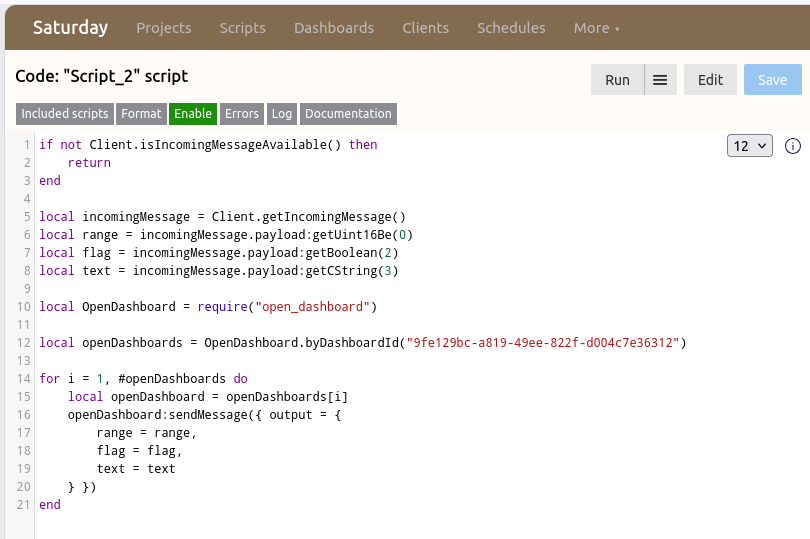

# Saturday

[English](../README.md) | [Українська]

---

> [!WARNING]
> **Статус розробки: Public Beta**
> Проєкт перебуває на стадії бета-тестування. Система повністю функціональна, але може містити невиявлені баги, нестабільний функціонал чи неточності в документації.

---
**Saturday** - це універсальний, локальний сервіс для гнучкої автоматизації, обробки даних та створення індивідуальних інтерфейсів для керування MQTT-екосистемою.

**Saturday** працює як інтелектуальний хаб-комбайн: сервіс отримує MQTT-трафік, обробляє його за допомогою швидких Lua-сценаріїв і дозволяє візуалізувати дані на повноцінних HTML/CSS/JS панелях, які ви створюєте самі.

### Як це працює

1. З'єднання: Сервіс підключається до зовнішнього MQTT-брокера (або використовує вбудований) для збору метрик і подій.  
2. Перехоплення подій: Підписка на потрібні топіки запускає виконання Lua-сценаріїв.  
3. Обробка та реакція: Lua-сценарій виконує бізнес-логіку (фільтрує, конвертує, аналізує дані) та миттєво відправляє результат: назад в MQTT, у Telegram-бот, зовнішню базу даних, HTTP Webhook або на панель (кастомний UI).

### Можливості

- Повна автоматизація на Lua: Пишіть легкі, швидкодійні сценарії для обробки повідомлень "на льоту" без необхідності перекомпіляції чи перезапуску всього сервісу.  
- Гнучкі тригери: Запуск сценаріїв за вхідними MQTT-повідомленнями, за точним розкладом (Cron/Таймери) або за внутрішніми подіями системи.  
- Кастомні панелі: Вбудований веб-сервер дозволяє відображати власні HTML/CSS/JS сторінки. Відображайте графіки, створюйте інтерактивні пульти керування та кастомізуйте UI під будь-який пристрій.  
- Локальність та приватність: Сервіс працює повністю локально, не залежить від хмарних провайдерів та гарантує максимальну швидкість відгуку і безпеку даних.  

---

### Сценарій

Описуйте свою бізнес-логіку з допомогою легких Lua сценаріїв. Налагодження роботи сценаріїв прямо в браузері.   

---

### Системні вимоги
Saturday — це Java-додаток (JAR), для роботи якого потрібна **JRE 1.8** або новіша.  
*Споживання RAM (на прикладі `ibm-semeru-open-jre-21`): ~200–300 MB.*

---

### Запуск

#### Варіант 1: Через Docker (з готовим середовищем)

В середині архіву `tar`-образ та всі, необхідні файли для роботи. Потрібна наявність Docker.

1. Перейдіть у розділ [Releases](https://github.com/gnoolson/saturday/releases) та завантажте архів `saturday-docker-***.zip`.
2. Розпакуйте архів у будь-який каталог.
3. Запустіть скрипт для вашої ОС:
   - **Linux:** `./start.sh`
   - **Windows:** `start.bat`
4. Відкрийте браузер за адресою `http://localhost:5050`.

*Щоб зупинити сервіс, запустіть `./stop.sh` або `stop.bat`.*

#### Варіант 2: Як звичайний JAR
1. Перейдіть у розділ [Releases](https://github.com/gnoolson/saturday/releases) та завантажте архів `saturday-jar-***.zip`.
2. Розпакуйте архів у будь-який каталог.
3. Запустіть скрипт для вашої ОС:
   - **Linux:** `./start.sh`
   - **Windows:** `start.bat`
4. Відкрийте браузер за адресою `http://localhost:5050`.

### Збірка проєкту з вихідного коду
- Збірка **Docker**-образу: `sh/docker_build.sh` (треба вказати `JRE_FOLDER` в сценарії)
- Збірка **JAR**: `sh/jar_build.sh`

*Результат збірки буде в каталозі `_dist`.*

Для збірки потрібно щоб каталог проєкту `saturday` був в одному каталозі з проєктом [saturday-plugins](https://github.com/gnoolson/saturday-plugins).

---

### Детальна документація
Повна документація доступна безпосередньо в самому додатку за адресою:  `http://localhost:5050/doc`

---

### Плагіни
Проєкт з плагінами тут [Saturday-plugins](https://github.com/gnoolson/saturday-plugins)

Інструкцію, як створити плагін, дивіться в документації.

---

### Демо-проєкти
Одразу після першого запуску вам будуть доступні декілька демонстраційних проєктів, які на практиці показують, як влаштована та працює **Saturday**.
За замовчуванням усі ресурси вимкнені. Щоб задіяти їх після першого старту:  
- Більше -> MQTT-брокер -> Запустити  
- Сценарії -> Увімкнути (усі сценарії)  
- Клієнти -> Підключити (усі клієнти)  
- Розклади -> Увімкнути (усі розклади)  